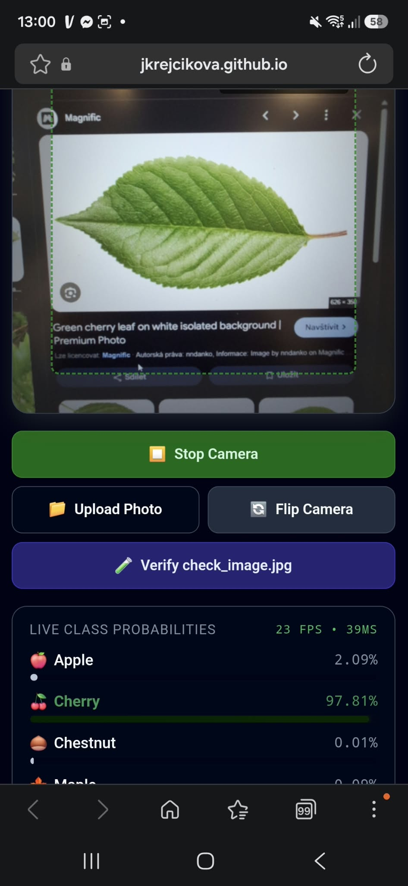
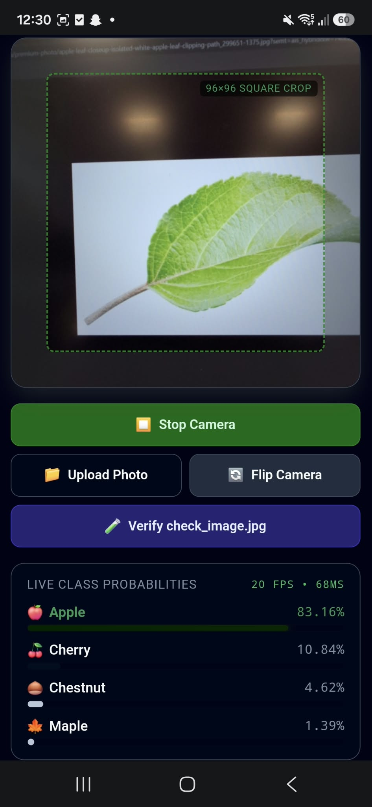
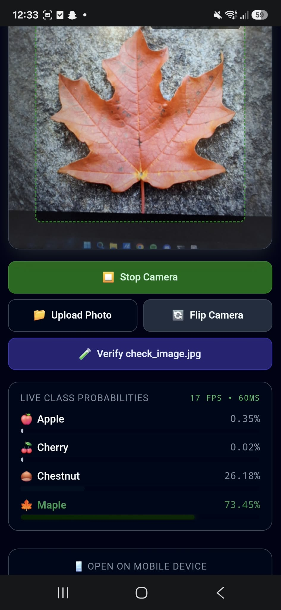
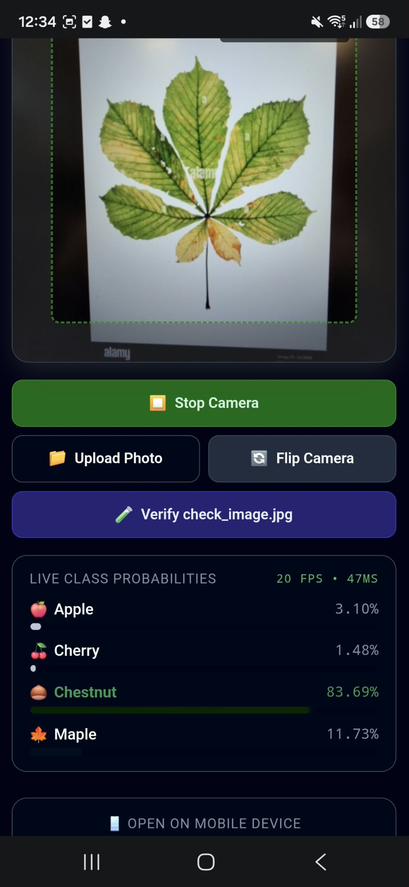

REVIEW of Task 2

1. Phone Execution
I opened the app on my phone at https://jkrejcikova.github.io/mlr-ex08/. The rear camera works directly in the browser and updates predictions live. Results from the camera are uploaded in the repository.

2. Numerical Verification (check_image.jpg)
I uploaded 'check_image.jpg' using the test button in the app and compared the results with 'check_expected.json'. The numbers match across all classes:
- Cherry: 1.00; 100 % (page) vs 0.99997 (expected)
- Chestnut: 2.65e-5 (page) vs 2.647e-5 (expected)
- Apple: 2.70e-6 (page) vs 2.699e-6 (expected)
- Maple: 1.99e-6 (page) vs 1.992e-6 (expected)

3. Preprocessing in index.html
I checked the image preprocessing code in 'index.html':
- The central square of the frame is cropped and resized to 96x96 pixels via canvas.
- Pixels are divided by 255 to scale RGB values to 0–1.
- Each channel is standardized using the mean and std from 'model_info.json' (mean: 0.485, 0.456, 0.406; std: 0.229, 0.224, 0.225).
- Data is converted to an NCHW Float32Array with shape [1, 3, 96, 96], matching the PyTorch transforms from the notebook.

4. Privacy & Network
I checked the Network tab in browser developer tools. Only the static files ('index.html', 'leaf_model.onnx', and ONNX Runtime Web from CDN) are downloaded at startup. No camera frames or images are sent to any external server; all inference runs entirely on the device.